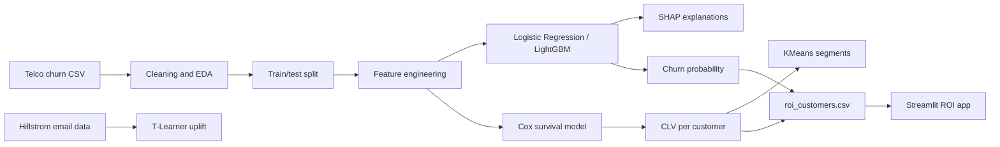

# Customer Churn and Lifetime Value Intelligence

Predicts which telecom customers will leave, how long they will stay, and whether a discount is worth offering. Built on the IBM Telco Customer Churn dataset (7,032 customers after cleaning), with the Hillstrom email campaign dataset (64,000 customers) used for uplift modeling.

Live demo: [Open the app](https://churn-roi-simulator-ftbkw29ceahy5qbnqfjx9e.streamlit.app/)

## What it does

1. Churn prediction: Logistic Regression and LightGBM, explained with SHAP.
2. Survival analysis: Kaplan-Meier curves and a Cox model for how long customers stay.
3. Customer lifetime value (CLV): expected months remaining multiplied by monthly bill.
4. Segmentation: KMeans groups customers by tenure and monthly bill.
5. Uplift: a T-Learner estimates which customers respond to an email.
6. ROI simulator: a Streamlit app that compares discount cost with expected savings.

## Results

| Model | Test ROC-AUC |
|---|---|
| Logistic Regression (raw columns) | 0.836 |
| Logistic Regression (with new features) | 0.835 |
| LightGBM (raw columns) | 0.826 |
| LightGBM (with new features) | 0.828 |

The engineered features did not measurably improve either model. The raw columns already carried most of the signal.

Other results:
- Cox model concordance: 0.85
- Uplift: the top 20% of customers by predicted uplift had a real lift of 1.34 percentage points, compared with 0.18 for the bottom 20%.
- ROI simulator (10% discount, 30% churn-risk reduction, 30% threshold): 526 customers targeted, net gain about $85,087. This result depends on the 30% assumption.

## Architecture



## Setup

```
pip install -r requirements.txt
streamlit run app.py
```


## Limitations

- The churn-reduction rate in the ROI simulator is an assumption, not a measured value.
- The Telco data has no offer or treatment column, so uplift uses the Hillstrom dataset instead.
- The Hillstrom data is from 2008 and describes a single email campaign.
